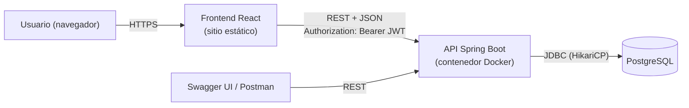
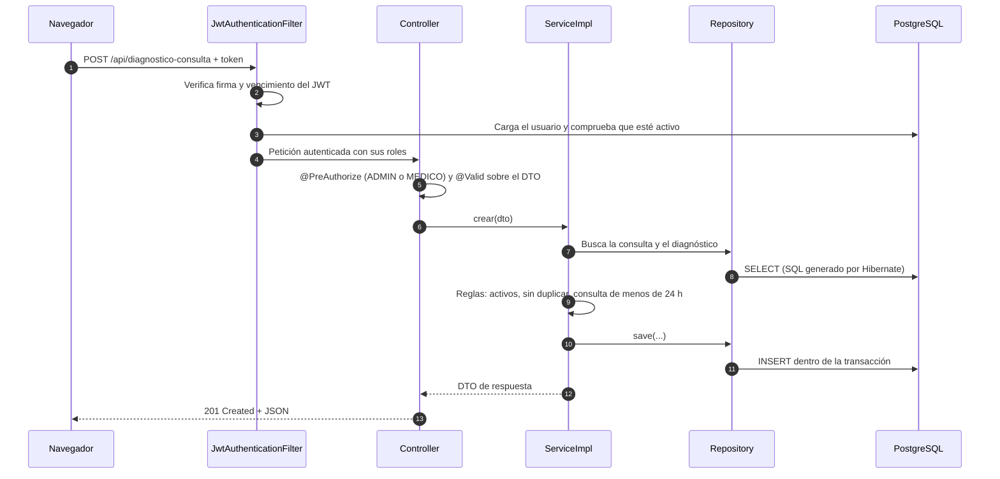
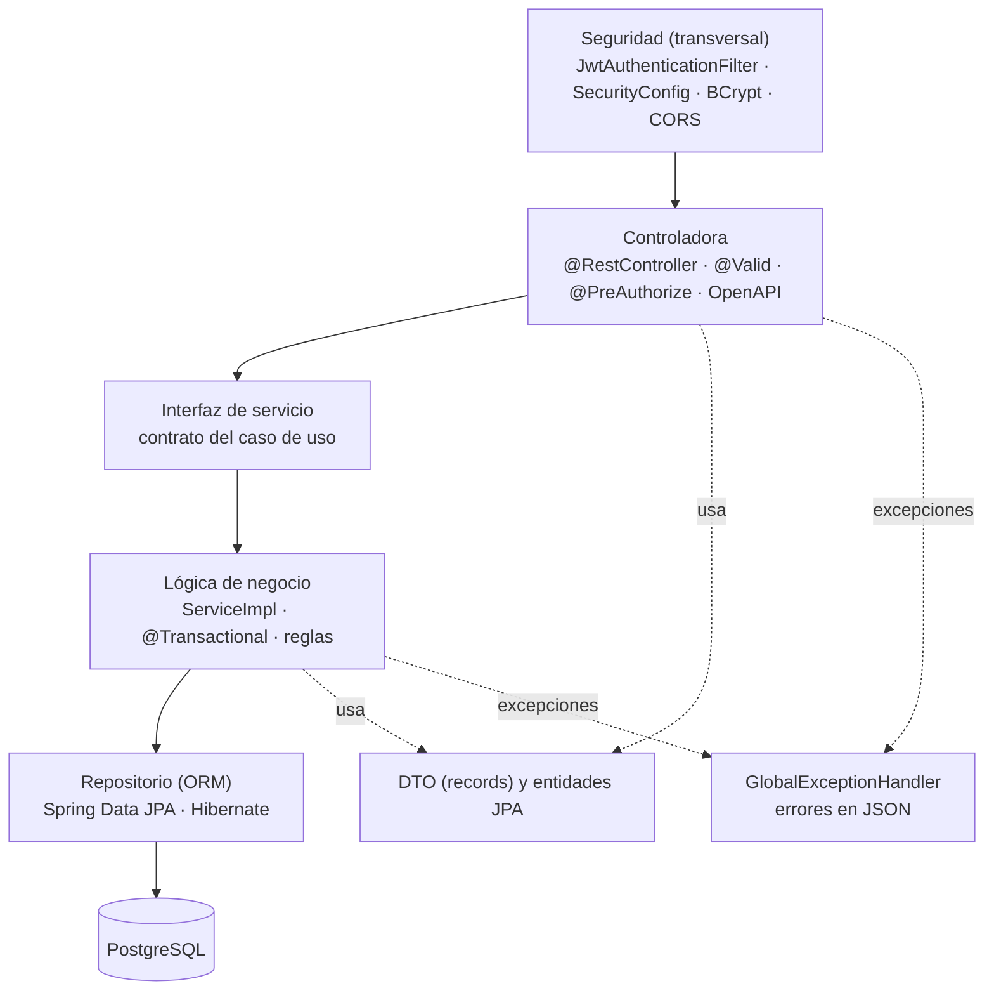
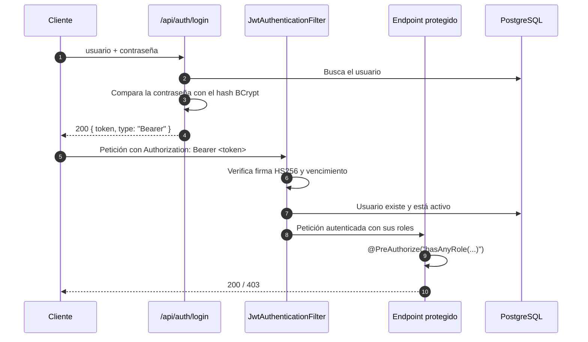
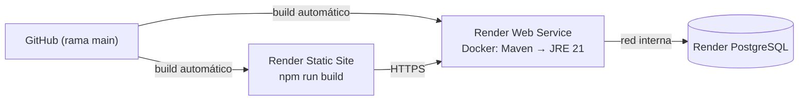

# Arquitectura del Sistema de Gestión Hospitalaria

Documento de presentación técnica del proyecto: cómo funciona el sistema, qué decisiones de arquitectura se tomaron y por qué. El detalle completo (modelo de datos tabla por tabla, matriz de permisos por recurso) está en [arquitectura.md](arquitectura.md), y la referencia de endpoints en [api.md](api.md).

---

## 1. Resumen

El sistema administra la operación de un hospital: pacientes, citas, consultas, diagnósticos y tratamientos, emergencias con triaje, hospitalizaciones, farmacia y facturación.

| Aspecto | Decisión |
|---|---|
| Estilo de arquitectura | Cliente-servidor: SPA + API REST. Backend como **monolito modular en capas** |
| Backend | Java 21, Spring Boot 4.1, Spring Security, Spring Data JPA (Hibernate) |
| Base de datos | PostgreSQL (38 tablas) |
| Autenticación | JWT sin estado (HS256) + contraseñas con BCrypt |
| Autorización | 6 roles, verificados por método con `@PreAuthorize` |
| Frontend | React 19 + Vite, React Router, axios, Bootstrap 4 (tema Now UI Dashboard) |
| Documentación de la API | OpenAPI 3 generada desde el código (Swagger UI) |
| Pruebas | 414 pruebas unitarias con JUnit 5 y Mockito sobre la capa de servicios |
| Despliegue | Render: API en contenedor Docker, PostgreSQL administrado y frontend como sitio estático, todo con HTTPS |

Tamaño: 40 controladores y 223 endpoints REST, organizados en 8 módulos de negocio (Autenticación, Administración, Pacientes, Clínica, Emergencias, Hospitalización, Farmacia y Facturación) más reportes.

---

## 2. Cómo funciona el sistema

### 2.1 Componentes



- El **frontend** es una aplicación de una sola página (SPA). Se compila a archivos estáticos y solo se comunica con la API por HTTP; no tiene acceso a la base de datos.
- La **API** concentra toda la lógica y las reglas de negocio. Es la única fuente de verdad: aunque el frontend oculte un botón o valide un formulario, el backend vuelve a validar todo.
- **PostgreSQL** guarda los datos. La API se conecta con JDBC a través de un pool de conexiones (HikariCP).

### 2.2 Recorrido de una petición

Ejemplo: un médico registra el diagnóstico de una consulta.



Si cualquier regla falla, el servicio lanza una excepción, la transacción se revierte y `GlobalExceptionHandler` responde con el formato de error estándar (sección 4.5).

---

## 3. Estilo de arquitectura y por qué se eligió

### 3.1 Cliente-servidor con API REST

Separar el frontend del backend mediante una API REST permite:

- **Independencia:** cada parte se desarrolla, prueba y despliega por separado. El frontend se publica como archivos estáticos y la API como un contenedor.
- **Un solo punto de reglas de negocio:** cualquier cliente (la SPA, Postman, Swagger o una futura app móvil) pasa por las mismas validaciones y permisos.
- **Contrato explícito:** la API se documenta sola con OpenAPI, y ese contrato es lo que comparten frontend y backend.

### 3.2 Monolito modular en lugar de microservicios

El backend es **una sola aplicación** dividida internamente por módulos de negocio. Se eligió así porque:

- **El dominio está muy relacionado.** Una consulta depende de una cita, un tratamiento de un diagnóstico, una factura de una hospitalización. Con microservicios, cada una de esas relaciones se convertiría en una llamada de red y en un problema de consistencia distribuida. En un monolito son una transacción local de la base de datos.
- **Transacciones ACID simples.** Registrar un pago y actualizar el estado de la factura, o atender una consulta y cambiar la cita a "Atendida", ocurre en una sola transacción: o se guarda todo o nada.
- **Tamaño del equipo y del proyecto.** Microservicios agregan infraestructura (descubrimiento de servicios, mensajería, varias bases de datos, observabilidad distribuida) que no aporta valor a este tamaño y complica el despliegue.
- **Costo de operación.** Un solo contenedor corre en el plan gratuito de Render.

Al estar organizado por módulos, el código queda preparado para extraer un módulo a un servicio aparte si en el futuro hiciera falta, porque cada módulo ya tiene sus propias capas y su propia interfaz de servicio.

### 3.3 Organización por módulo (package by feature)

Cada módulo de negocio es un paquete con todas sus capas:

```
hospital/src/main/java/com/example/hospital/
├── consultas/
│   ├── ConsultasController.java        capa de presentación (REST)
│   ├── ConsultasService.java           interfaz del caso de uso
│   ├── impl/ConsultasServiceImpl.java  lógica de negocio
│   ├── ConsultasRepository.java        acceso a datos (Spring Data JPA)
│   ├── Consultas.java                  entidad JPA
│   └── dto/ConsultasDTO.java           objeto de entrada/salida con validaciones
├── citas/ … pagos/ … hospitalizaciones/ …   (40 módulos con la misma estructura)
└── shared/
    ├── config/      SecurityConfig, SwaggerConfig, DataInitializer
    ├── security/    JwtService, JwtAuthenticationFilter, UsuarioDetailsService
    ├── exception/   GlobalExceptionHandler, ErrorResponse, excepciones de negocio
    └── catalogos/   EstadosCatalogo
```

Se prefirió a la organización por capa técnica (todos los controladores juntos, todos los servicios juntos) porque todo lo de un caso de uso queda en un mismo lugar: para cambiar "consultas" solo se abre el paquete `consultas`.

---

## 4. Arquitectura del backend

### 4.1 Capas



| Capa | Responsabilidad | Lo que no hace |
|---|---|---|
| **Controladora** | Expone el endpoint, valida el formato de la entrada (`@Valid`), declara qué roles pueden usarlo (`@PreAuthorize`) y traduce el resultado a un código HTTP. | No tiene lógica de negocio ni accede a repositorios. |
| **Interfaz de servicio** | Define el contrato de cada caso de uso. | No tiene código. Permite sustituir la implementación por un mock en las pruebas. |
| **Lógica (ServiceImpl)** | Aplica las reglas de negocio, maneja la transacción y decide qué error devolver. Convierte entidades en DTO. | No conoce HTTP ni la seguridad. |
| **Repositorio** | Acceso a datos con Spring Data JPA: consultas derivadas del nombre del método (`findByIdCita`, `existsByIdDiagnosticoAndIdConsulta`). | No aplica reglas. No hay SQL escrito a mano. |
| **Entidades y DTO** | Las entidades representan las tablas; los DTO son lo que entra y sale de la API. | La API nunca expone entidades directamente. |

**Por qué esta separación:** cada capa tiene un solo motivo para cambiar. Las reglas de negocio se prueban sin levantar un servidor ni una base de datos (se mockean los repositorios), y un cambio en la forma de la API (DTO) no obliga a cambiar la tabla (entidad), ni al revés.

### 4.2 DTO y validación en dos niveles

Los DTO son `record` de Java con anotaciones de Bean Validation (`@NotBlank`, `@Size`, `@DecimalMin`, `@PastOrPresent`…).

1. **Validación de formato (controladora):** si un campo no cumple su anotación, la API responde **400** con un mapa `detalles` campo → mensaje, que el frontend muestra debajo de cada campo.
2. **Validación de negocio (servicio):** reglas que dependen del estado de los datos, por ejemplo "la cita debe estar Confirmada" o "el monto no puede superar el saldo". Responden **422**.

### 4.3 Transacciones

Los métodos que escriben llevan `@Transactional`. Si una regla falla a mitad de un caso de uso, Spring revierte todo lo hecho. Ejemplos:

- Registrar una consulta cambia la cita a "Atendida" en la misma transacción.
- Registrar un médico o enfermero crea también su usuario de acceso; si falla la creación del usuario, no se registra el profesional.
- Un pago actualiza el saldo y, si corresponde, marca la factura como Pagada.

Además, `spring.jpa.open-in-view=false`: la conexión a la base se libera al terminar el servicio y no queda abierta mientras se escribe la respuesta HTTP.

### 4.4 Reglas de negocio destacadas

| Regla | Dónde vive |
|---|---|
| **Máquina de estados de la cita:** Programada → Confirmada → En curso → Atendida, con salidas a Cancelada, No asistió o Reprogramada. Cualquier otra transición se rechaza. | `EstadoCitaServiceImpl` |
| **Una consulta por cita**, solo de citas Confirmadas o En curso cuya fecha ya llegó. | `ConsultasServiceImpl` |
| **Consultas históricas:** una consulta solo se modifica (datos y diagnósticos asociados) durante las 24 horas siguientes a la atención. Después es de solo lectura. | `VentanaEdicionConsulta` |
| **Importes calculados por el servidor:** subtotal, IVA (configurable) y total de la factura no los envía el cliente. | `CalculoImportes` |
| **Borrado lógico:** los registros se desactivan (`activo = false`) en lugar de borrarse, para conservar el historial clínico y contable. No se puede desactivar un registro con dependientes activos. | Cada servicio |
| **Estados base protegidos:** los estados que usa el código (por ejemplo Activa o Alta en una hospitalización) se buscan por nombre y no se pueden renombrar ni desactivar. | `EstadosCatalogo` |

### 4.5 Manejo de errores

Todas las excepciones pasan por `GlobalExceptionHandler` (`@RestControllerAdvice`) y se devuelven con el mismo formato JSON:

```json
{
  "timestamp": "2026-11-09T10:30:00",
  "status": 422,
  "error": "Unprocessable Entity",
  "message": "La consulta #1 del 07/11/2026 14:42 ya no se puede modificar: ...",
  "path": "/api/consultas/1",
  "detalles": {}
}
```

| Código | Cuándo |
|---|---|
| 400 | Datos con formato inválido (`detalles` indica cada campo) |
| 401 | Sin token, token inválido o vencido, usuario inactivo |
| 403 | Token válido pero el rol no tiene permiso |
| 404 | El recurso no existe |
| 409 | Duplicado o conflicto (por ejemplo, una segunda consulta para la misma cita) |
| 422 | Regla de negocio incumplida |
| 500 | Error inesperado (se registra en el log; al cliente no se le muestra el detalle interno) |

Los errores 401 y 403 que produce la capa de seguridad (antes de llegar al controlador) usan el mismo formato gracias a `RestSecurityErrorHandler`.

### 4.6 Observabilidad y documentación

- **Logs con el usuario:** el filtro JWT coloca el nombre del usuario en el MDC de SLF4J, y cada línea del log de esa petición muestra quién la hizo. Los archivos de log rotan cada 10 MB y se conservan 30 días.
- **Swagger UI / OpenAPI 3:** se genera desde las anotaciones de los controladores e incluye roles, códigos de respuesta y ejemplos. Permite probar la API con el token desde el navegador.

---

## 5. Base de datos: PostgreSQL

### 5.1 Por qué PostgreSQL

| Necesidad del sistema | Cómo la cubre PostgreSQL |
|---|---|
| Datos muy relacionados (paciente → cita → consulta → diagnóstico → tratamiento → medicamentos; hospitalización → cuenta → factura → pagos) | Modelo relacional con claves foráneas: la base impide, por ejemplo, un pago de una factura que no existe. |
| Operaciones de dinero y de historial clínico que no pueden quedar a medias | Transacciones ACID completas. |
| Reglas que deben cumplirse aunque alguien escriba directo en la base | Restricciones `CHECK`, `UNIQUE` y `NOT NULL` en el esquema (por ejemplo `sexo IN ('M','F')` o un DPI único). |
| Consultas por fecha, paciente o estado | Índices sobre las columnas de búsqueda (`migraciones/001_restricciones_e_indices.sql`). |
| Despliegue sin costo de licencia | Código abierto, con servicio administrado en Render. |

**Frente a las alternativas:**

- **MySQL / MariaDB:** también es relacional y habría funcionado. Se prefirió PostgreSQL por su cumplimiento más estricto del estándar SQL, el soporte completo de `CHECK` constraints, columnas `IDENTITY` estándar y el servicio administrado disponible en Render.
- **MongoDB u otra NoSQL:** se descartó. El dominio es relacional por naturaleza y necesita integridad referencial y transacciones entre varias entidades; en un modelo de documentos esas garantías habría que reimplementarlas en el código.

### 5.2 Gestión del esquema

- El esquema lo define el script `hospital/Hosp_postgres.sql` (38 tablas, índices y datos iniciales de catálogos). **Hibernate no crea ni modifica tablas** (no se configura `ddl-auto`, que con PostgreSQL queda en `none`): así se evitan cambios accidentales en la base de producción y el esquema queda versionado y revisable en Git.
- Los cambios sobre una base ya desplegada se aplican con scripts numerados en `hospital/migraciones/` (`001`, `002`…).
- La API se conecta con un pool de conexiones HikariCP, configurado por variables de entorno (`DB_URL` o `DB_HOST`, `DB_PORT`, `DB_NAME`, `DB_USER`, `DB_PASSWORD`).

---

## 6. Autenticación y autorización

### 6.1 Tipo de autenticación: JWT sin estado

El sistema usa **tokens JWT (JSON Web Token)** firmados con **HMAC-SHA256 (HS256)**.



**Contenido del token:** el nombre de usuario (`sub`), sus roles (`roles`), la fecha de emisión y la de vencimiento (1 hora por defecto, configurable con `JWT_EXPIRATION_MS`). El secreto de firma se toma de la variable de entorno `JWT_SECRET`; sin ella la aplicación no arranca.

**Por qué JWT y no sesiones en el servidor:**

- **Sin estado (stateless):** el servidor no guarda sesiones en memoria. Cualquier instancia de la API puede atender cualquier petición, lo que permite escalar horizontalmente y reiniciar el servicio sin cerrar la sesión de nadie.
- **Encaja con una SPA y una API en dominios distintos:** el token viaja en el encabezado `Authorization`, no en cookies. Por eso no se necesita protección CSRF (está desactivada) y CORS solo permite el origen del frontend (`CORS_ORIGINS`).
- **Estándar:** lo entiende cualquier cliente HTTP (Postman, Swagger, una app móvil).

**Desventaja de JWT y cómo se mitigó:** un token no se puede "revocar" antes de que venza. Para cubrirlo, el filtro **consulta el usuario en cada petición**: si un administrador lo desactiva, sus tokens dejan de funcionar de inmediato aunque no hayan vencido.

### 6.2 Contraseñas

- Se guardan con **BCrypt** (hash con sal aleatoria por contraseña y costo de trabajo 10). Nunca se guardan ni se registran en texto plano; los logs solo indican el usuario y el motivo de un login fallido.
- Al registrar un médico o enfermero, el sistema crea su usuario con una **contraseña temporal aleatoria** (con mayúscula, minúscula, número y símbolo) que vale **24 horas** y se muestra una sola vez.
- Mientras la contraseña es temporal, el frontend solo permite entrar a la pantalla de cambio de contraseña (`POST /api/auth/cambiar-password`). Si vence, el login la rechaza (422) y un administrador debe asignar otra.
- El vencimiento se comprueba **después** de validar la contraseña, para no revelar a un tercero qué cuentas tienen una contraseña temporal.

### 6.3 Autorización por roles

| Rol | Acceso principal |
|---|---|
| `ADMIN` | Todo el sistema, incluida la administración de usuarios, personal y catálogos |
| `MEDICO` | Consultas, diagnósticos, tratamientos, emergencias, hospitalizaciones, recetas |
| `ENFERMERO` | Lectura clínica, emergencias, triaje, hospitalizaciones |
| `RECEPCIONISTA` | Pacientes, citas y agenda, ingreso a emergencia, registro de hospitalizaciones y apoyo en caja |
| `FARMACEUTICO` | Medicamentos y stock |
| `CAJERO` | Cuentas, facturas y pagos (con acceso mínimo a datos del paciente) |

- Los permisos se declaran **en cada método** del controlador con `@PreAuthorize("hasAnyRole('ADMIN','MEDICO')")`, de modo que al leer un endpoint se ve quién puede usarlo.
- **Principio de mínimo privilegio:** por ejemplo, el cajero no puede leer la ficha clínica del paciente; tiene endpoints de "resumen" que devuelven solo nombre y DPI.
- Las únicas rutas públicas son el login y la documentación Swagger. Todo lo demás exige un token válido.
- El frontend replica los permisos (oculta menús y botones según el rol) solo por usabilidad; la seguridad real está en el backend.

---

## 7. Frontend

- **React 19 + Vite:** compilación rápida y salida estática que se sirve desde cualquier hosting de archivos.
- **React Router:** rutas protegidas (`ProtectedRoute` exige sesión; `RoleRoute` exige el rol).
- **axios** con un interceptor que agrega el token a cada petición y, ante un 401, cierra la sesión y lleva al login.
- **Bootstrap 4 + reactstrap** con el tema Now UI Dashboard, y componentes propios reutilizables (formularios, tablas, alertas, diálogo de confirmación, CRUD genérico de catálogos).
- La configuración de menús y permisos por rol está centralizada en `config/menu.js`.

---

## 8. Calidad y pruebas

- **414 pruebas unitarias** (JUnit 5 + Mockito) sobre la capa de servicios: reglas de negocio, transiciones de estado, cálculos de facturación, permisos de datos y casos de error (404, 409, 422).
- Se prueban sin base de datos ni servidor, gracias a la separación interfaz/implementación: los repositorios se reemplazan por mocks.
- La prueba de integración con PostgreSQL es opcional (solo corre si existe `DB_PASSWORD`).
- Detalle por módulo en [pruebas.md](pruebas.md).

---

## 9. Configuración y despliegue



- **Contenedor en dos etapas:** la primera compila el `.jar` con Maven y JDK 21; la segunda solo lleva el JRE y el `.jar`, lo que reduce el tamaño de la imagen. La JVM está ajustada para los 512 MB del plan gratuito.
- **Configuración por variables de entorno** (principio de *twelve-factor app*): base de datos, secreto JWT, contraseña del administrador inicial, orígenes CORS, IVA y puerto. **Ningún secreto está en el código**: las variables obligatorias no tienen valor por defecto y la aplicación no arranca sin ellas. En desarrollo pueden ir en un archivo `hospital/.env`, que Git ignora.
- **HTTPS** en todos los componentes, terminado por el proxy de Render (`server.forward-headers-strategy=framework`).
- Guía paso a paso en [despliegue-render.md](despliegue-render.md).

---

## 10. Limitaciones conocidas y mejoras posibles

| Limitación | Mejora propuesta |
|---|---|
| No hay *refresh token*: al vencer el token (1 hora) hay que iniciar sesión de nuevo. | Agregar *refresh tokens* de larga duración guardados y revocables en la base. |
| El token se guarda en `localStorage`, expuesto si hubiera una vulnerabilidad XSS. | Moverlo a una cookie `HttpOnly` + `SameSite` (requeriría reactivar protección CSRF). |
| Las migraciones son scripts manuales numerados. | Adoptar Flyway o Liquibase para aplicarlas automáticamente al arrancar. |
| No hay pruebas automáticas de la interfaz. | Pruebas end-to-end con Playwright. |
| Un único servidor en el plan gratuito (se suspende tras 15 minutos sin uso). | Plan con instancia siempre activa; al ser *stateless*, la API se puede replicar sin cambios. |
